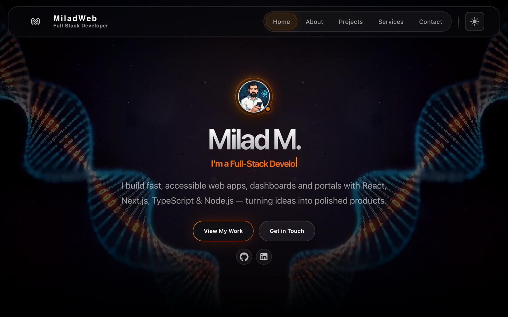

<div align="center">

# 🧑‍💻 MiladWeb — Developer Portfolio

My personal portfolio: a fast, SEO-optimized single-page site that presents my projects, skills and services, with dark and light themes and a filterable project gallery.

<a href="https://miladweb.com/"></a>
<a href="https://github.com/miladmo68/Miladweb-Portfolio"></a>
<a href="https://miladweb.com"></a>

**🔗 Live:** [miladweb.com](https://miladweb.com/)

</div>

<p align="center">
  
</p>

## ✨ Features

- Filterable project gallery that alternates Web App and Web Design work
- Live, Code and Preview actions on every project card
- Dark and light themes with a cinematic hero video
- Full SEO setup: Open Graph, Twitter cards, JSON-LD and sitemap
- Optimized screenshots for a light page weight

## 🛠️ Tech Stack

        

## 🚀 Getting Started

**Prerequisites:** [Node.js](https://nodejs.org/) 18 or newer

**Install and run**

```bash
git clone https://github.com/miladmo68/Miladweb-Portfolio.git
cd Miladweb-Portfolio
npm install
npm run dev
```

### Environment variables

Create a `.env` file (or `.env.local` for Next.js) with:

```env
EMAIL_PASS=
EMAIL_TO=
EMAIL_USER=
```

## 📁 Project Structure

```
Miladweb-Portfolio/
├── api/
├── app/
├── components/
├── public/
├── scripts/
├── src/
├── styles/
├── eslint.config.js
├── FINAL_OPTIMIZATION_SUMMARY.md
├── index.html
├── MERN-APP.png
├── next.config.mjs
├── NEXTJS_MIGRATION_GUIDE.md
└── OPTIMIZATION_SUMMARY.md
```

## 👤 Author

**Milad Mohammadi** — Frontend-Focused Full-Stack Developer, Toronto 🇨🇦

[](https://miladweb.com)
[](https://www.linkedin.com/in/miladmo68/)
[](https://github.com/miladmo68)

<p align="center"><sub>If you like this project, consider giving it a ⭐</sub></p>
